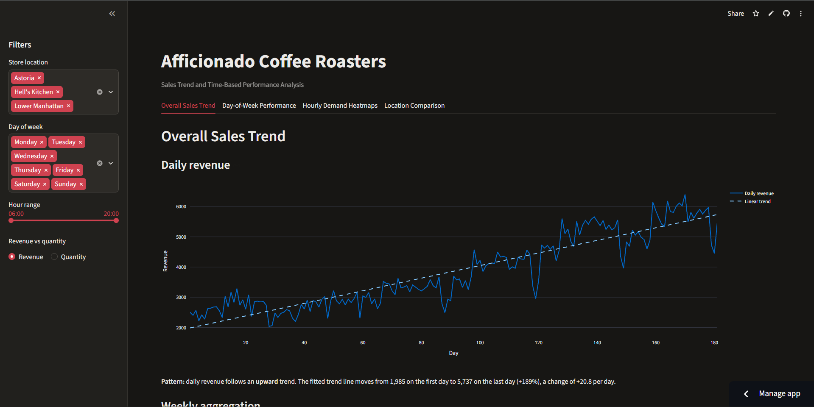
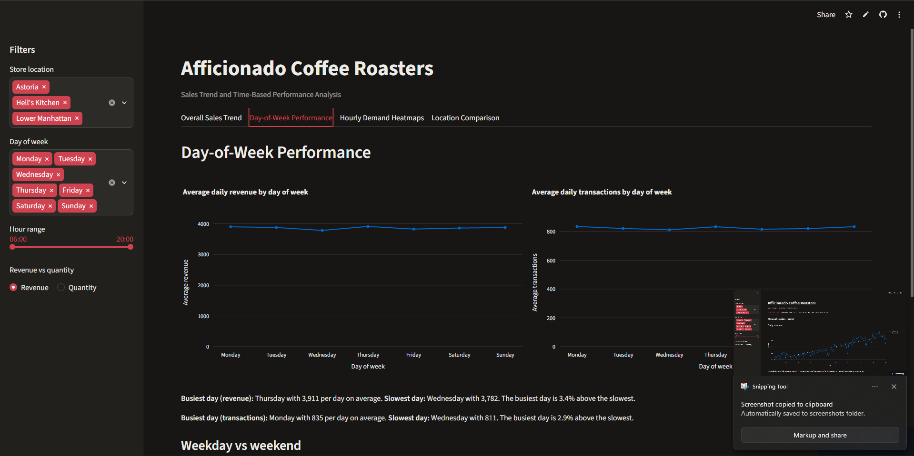
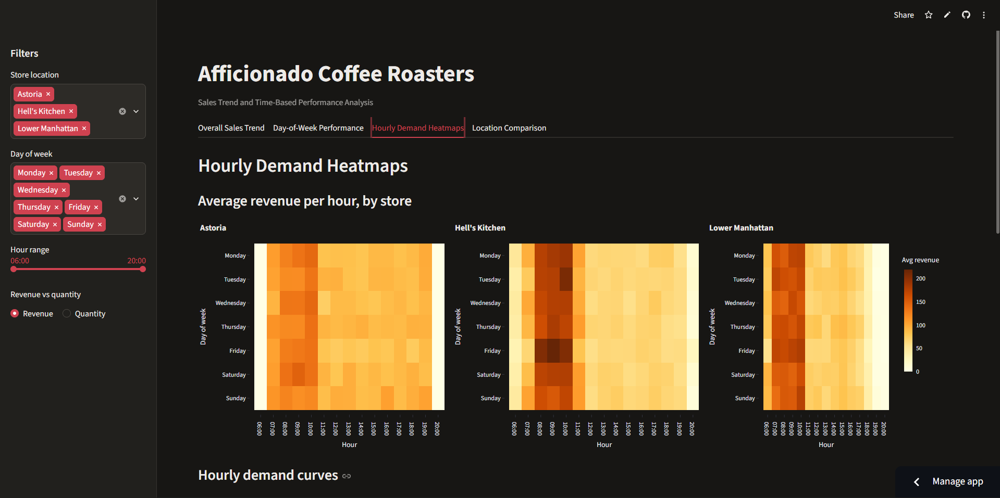
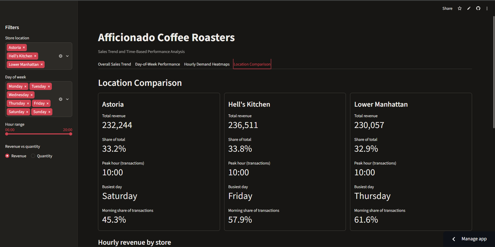

# ☕ Afficionado Coffee Roasters: Sales Trend & Time-Based Performance Analytics

An interactive analytics dashboard built using Python and Streamlit that shows **when sales occur** at Afficionado Coffee Roasters: across the overall sales trend, the days of the week, the hours of the day and the store locations, using transaction-level sales data.

This project combines:

- 📊 Overall sales trend and store-level trend analysis
- 📅 Day-of-week performance analysis
- 🕒 Hourly demand heatmaps for each store
- 📍 Cross-location comparison of temporal demand
- 🎛️ Interactive filters for store, day, hour range and revenue vs quantity

---

## 🚀 Features

### 📌 Core Modules
The dashboard is organised into four modules:

- Overall Sales Trend
- Day-of-Week Performance
- Hourly Demand Heatmaps
- Location Comparison

### 🎛️ User Capabilities
Every chart, table and written finding updates with these sidebar controls:

- ✅ Store location filter
- ✅ Day-of-week selector
- ✅ Hour-range slider
- ✅ Revenue vs quantity toggle

---

## 🧮 Derived Features Used

The application engineers the following features from the raw transactions:

- Revenue per transaction (quantity × unit price)
- Hour of day (0–23)
- Day of week (Monday–Sunday) and weekday / weekend type
- Week number (blocks of 7 days)
- Time buckets:
  - Morning (6–11)
  - Afternoon (12–16)
  - Evening (17–21)
  - Late hours (22–5)

---

## 🧪 Validation & Methodology

### Data Validation
Five checks run before any analysis. Rows that fail a check are excluded:

- Valid time format (HH:MM:SS)
- No missing transaction IDs
- No duplicate transaction IDs
- Positive quantities
- Positive unit prices

### Analysis Steps
- Daily revenue trends with a fitted trend line
- Weekly aggregation of revenue and transactions, with week-over-week change
- Identification of upward / downward patterns
- Average revenue and transaction count by day of week
- Weekday vs weekend comparison
- Hourly transaction volume and revenue distribution
- Identification of morning rush hours, midday slow periods and evening peaks
- Hourly heatmaps per store
- Peak-hour alignment or divergence across locations

---

## 🗂️ Dataset

`Afficionado_Coffee_Roasters.xlsx` holds one row per transaction (sheet: `Transactions`):

| Column | Description |
|---|---|
| `transaction_id` | Unique identifier per transaction |
| `year` | Transaction year (2025) |
| `transaction_time` | Time of transaction (HH:MM:SS) |
| `transaction_qty` | Quantity purchased |
| `unit_price` | Price per unit |
| `store_id` | Store identifier |
| `store_location` | Physical store location |
| `product_id` | Unique identifier for each product |
| `product_category` | Broad product group |
| `product_type` | Product variant within the category |
| `product_detail` | Detailed attributes such as flavor or blend |

---

## 🖥️ Dashboard Tabs

### 📈 Overall Sales Trend
- Daily revenue (or quantity) trend with a fitted trend line
- Weekly aggregation charts and table (revenue, quantity, transactions, week-over-week change)
- Store-level trend comparison (daily and weekly) with a trend summary table

### 📅 Day-of-Week Performance
- Average daily revenue (or quantity) and transactions by day of week
- Busiest and slowest day
- Weekday vs weekend comparison

### 🕒 Hourly Demand Heatmaps
- One heatmap per store (day of week × hour)
- Hourly transaction volume curve and hourly revenue (or quantity) distribution
- Peak transaction hours, morning rush hours, midday slow periods and evening peak
- Time-bucket summary table

### 📍 Location Comparison
- One panel per store: total, share of total, peak hour, busiest day and morning share
- Hourly demand by store
- Peak-hour alignment across stores
- Location-specific behaviour table

---

## 📈 Visualizations

Interactive charts powered by Plotly:

- Daily Trend Line with Fitted Trend
- Weekly Revenue and Weekly Transactions Bar Charts
- Store-Level Daily and Weekly Trend Lines
- Day-of-Week Line Charts
- Weekday vs Weekend Lollipop Charts
- Per-Store Hourly Heatmaps
- Hourly Transaction Volume Curve and Hourly Distribution Chart
- Hourly Demand by Store Line Chart

---

## 🛠️ Technologies Used

### Programming Language
- Python

### Libraries & Frameworks
- Streamlit
- Pandas
- NumPy
- Plotly
- openpyxl

---

## 📂 Project Structure

```bash
├── app.py                          # Streamlit dashboard (main entry point)
├── data_processing.py              # Data loading, validation, feature engineering, aggregations
├── requirements.txt
├── README.md
├── Code_Walkthrough.md             # File-by-file explanation of the code
├── Afficionado_Coffee_Roasters.xlsx
```

---

## ⚙️ Installation

### 1️⃣ Clone the Repository

```bash
git clone https://github.com/Sheikh-13/<your-repository-name>.git
cd <your-repository-name>
```

---

### 2️⃣ Install Dependencies

```bash
pip install -r requirements.txt
```

---

### 3️⃣ Run the Application

```bash
streamlit run app.py
```

> ⏱️ The first load reads and processes the Excel file once. Every interaction after that is served from cache.

---

## 📦 Requirements

```txt
streamlit>=1.50
pandas
numpy
plotly
openpyxl
```

---

## 📊 Analytical Workflow

```text
Raw Transactions (Excel)
      ↓
Data Validation (time format, missing / duplicate IDs, positive quantity and price)
      ↓
Day Sequencing (days counted from time-of-day resets, day 1 = 1 January 2025)
      ↓
Feature Engineering (revenue, hour, day of week, week number, time bucket)
      ↓
Aggregation (daily, weekly, hourly, per store)
      ↓
Sidebar Filters (store, day, hour range, revenue vs quantity)
      ↓
Dashboard Visualization
```

---

## 🎯 Analytical Output

The dashboard reports, for the selected stores, days and hours:

- 📈 Overall sales trend and its direction
- 📅 Busiest and slowest days of the week
- ⚖️ Weekday vs weekend demand
- 🕒 Peak transaction hours, morning rush hours, midday slow periods and evening peak
- 📍 Store-by-store comparison of hourly demand and peak-hour alignment

---

## 📸 Snapshots

<div align="center">

### **Overall Sales Trend**
*Daily trend, weekly aggregation & store-level comparison*



### **Day-of-Week Performance**
*Average by day of week & weekday vs weekend*



### **Hourly Demand Heatmaps**
*Per-store heatmaps & hourly demand curves*



### **Location Comparison**
*Store panels & peak-hour alignment*



</div>

---

## 📚 Educational Purpose

This project was developed as an internship/project work.

It demonstrates practical applications of:

- Time-Based Sales Analytics
- Exploratory Data Analysis
- Feature Engineering
- Interactive Dashboard Development

---

## ⚠️ Disclaimer

This project is developed for educational and research purposes only.

Findings describe historical sales patterns in the dataset provided and should complement, not replace, management judgment. The dataset contains no labour or cost information, so any staffing guidance drawn from this tool is based on demand alone.

---

## 👨‍💻 Author

Developed by **Sheikh Tauheed**

Internship Project - Data Science

**LinkedIn**: [Sheikh Tauheed](https://www.linkedin.com/in/sheikh-tauheed-82100026a/)

**Github**: [Sheikh-13](https://github.com/Sheikh-13)

---

## ⭐ Future Improvements

- True transaction dates in the source data
- Staff hours and labour costs to estimate the cost impact of scheduling changes
- A longer sales history (at least a full year) to identify seasonality
- Demand forecasting and staff-scheduling models
- Live data connector (replace the static Excel file with a refreshed feed)
- Deployment on cloud platforms
